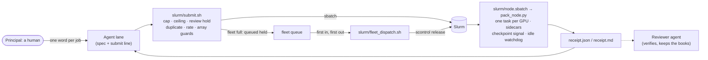

# Ganymede

**Guardrails for fleets of AI agents sharing one Slurm allocation.**

In myth, Ganymede was Jupiter's cupbearer. Slurm is named after a drink. A royal cupbearer's real job was to check what went into the king's cup before the king drank it. Ganymede does that for a supercomputer: every job an agent pours is checked against its budget, the fleet's node ceiling and a human's sign-off before it reaches the machine. Afterwards, a receipt shows what each GPU actually did.

Ganymede was built for a fleet of AI agents supporting our company's research and development on **JUPITER**, Europe's first exascale system at the Jülich Supercomputing Centre (JSC), and has run there since September 2026. Everything runs in user space on an ordinary project account: no admin rights, no daemon, no database. Slurm stays the scheduler; Ganymede is the one door to it.

## Why

Ganymede grew out of a year of running agent fleets. That experience helped us anticipate many of the risks of sharing budgets, compute and a working tree, and we built the first version to address them from the outset.

In September 2026 we gave a dozen AI agents one GPU allocation on JUPITER and one human to answer to. Each agent ran its own line of research and development as a long-running session on the machine's login nodes. Working in close collaboration with our human team, the agents designed experiments, wrote the code, asked for the jobs, read the results and wrote them up. Fleets of agents like this are new. Nobody has a settled playbook for running them yet, us included, and we learned as we went. The first weeks on JUPITER put those safeguards to the test. Further issues and near misses led us to strengthen existing guards and add new ones ([lessons learned](docs/lessons-learned.md)).

What can go wrong when many agents share one allocation:

- Agents retry. A failed submit can become a loop, and a loop can become a flood of jobs.
- GPUs can sit idle behind a stalled runner while the allocation drains.
- A shared budget can be spent faster than anyone notices.
- Agents can step on each other's work in a shared repository.
- Without a clear record, it can be impossible to tell afterwards who ran what, on whose authority, or whether the hours bought anything.

And two more risks that become especially important as the fleet grows:

- **The login nodes are shared.** A dozen agent sessions running tests, builds and probes add up, beside every other user of the machine. A node that falls over can take everyone's work with it, other projects' included.
- **The scheduler is shared too.** Every budget check and every status check is a query to the accounting database the whole machine uses. A check that rereads everything on every call can get heavier as the fleet grows, to the point that the database cuts off its answers.

Ganymede is the small set of tools and rules that let such a fleet run for weeks without a human watching every job, while a human still approves every one, and while the fleet stays a good neighbour on a machine it shares with everyone else.

It is for anyone running agents, or people, on a shared Slurm allocation they do not administer. It is not a scheduler: Slurm stays the scheduler. It is not an agent framework: bring your own agents. And it is not a sandbox: a job runs whatever its spec says, which is why a human's approval stays in the loop.

We are sharing it early because everyone running agent fleets is learning the same lessons at the same time. If you run one, tell us what broke for you.

## What it gives you

- **One door to Slurm.** [`slurm/submit.sh`](slurm/submit.sh) checks every submission: a GPU-hour cap per lane (agent), a fleet ceiling on nodes in flight with a first-in-first-out queue, a hold for human review above a cost threshold, and guards against duplicate jobs, submit storms, unthrottled arrays and requeues. Every guard fails closed: if Slurm cannot be read, nothing is submitted.
- **Whole-node packing.** [`pack_node.py`](pack_node.py) runs one task per GPU plus CPU sidecars and command pools on the spare cores, pins cores (NUMA-local on GH200), forwards Slurm's checkpoint warning to every task, and refuses a spec that would leave a GPU idle.
- **A receipt for every job.** Per task: wall time, exit code, CPU seconds, peak memory. Per GPU: utilisation and active SMs from the Hopper GPM counters, sampled through the course of the job. Every GPU-hour has evidence behind it.
- **A GPU-idle watchdog.** A job whose GPUs all sit under 1 % for 45 minutes is ended and recorded as a failure, so a stalled runner cannot burn a node for hours.
- **Accounting that holds up, lightly.** Budget by lane from Slurm accounting, read for your account only in weekly windows with finished weeks cached, so a check costs the shared scheduler almost nothing; an allocation ledger, a one-screen fleet status, and a waiter that trusts the scheduler only when accounting agrees.
- **Many agents, one git checkout.** [`git/lanegit.sh`](git/lanegit.sh) gives every agent short, scoped commits that never refresh the whole index under the lock, and pushes that never touch the working tree. [`git/ffscoped.py`](git/ffscoped.py) brings outside work in without a race. Size hooks keep outputs out of git.
- **An operating model.** [`docs/operating-model.md`](docs/operating-model.md) describes how the original fleet ran: a human gives one word per job, the word is recorded verbatim with its time, and a reviewer agent checks the books.
- **Light on the login nodes.** Agents live on shared login nodes. [`tools/login_check.py`](tools/login_check.py) looks before anything heavy runs there: load, the least-busy cores, your memory against your per-user limit, other users on the login GPU. It answers GO, REDUCE or WAIT with the command prefix to use; [`docs/login-nodes.md`](docs/login-nodes.md) has the rules the fleet kept.
- **Tested against a fake Slurm.** [`tests/fleet_guard/run_tests.sh`](tests/fleet_guard/run_tests.sh) runs 56 checks on any laptop, with no scheduler and no GPU.

## How a job flows



## In production

The first deployment, on JUPITER Booster (four NVIDIA GH200 per node), from 18 September to 1 November 2026:

| | |
|---|---|
| fleet jobs | 995 |
| completed / failed / cancelled / timed out | 848 / 128 / 13 / 6 |
| GPU-hours | about 4,860 |
| agent lanes sharing the account | 12, plus a calibration lane |
| tooling releases | 15 in six and a half weeks |

Slurm records a job as failed when its batch step exits non-zero, which here means a task did not exit 0 or the launcher refused the spec; the agents' own experiment failures are counted there, and the receipt says which task failed and how. The incidents that further shaped the tools are in [`docs/lessons-learned.md`](docs/lessons-learned.md).

## Quick start

```bash
git clone <this repository> ganymede && cd ganymede
bash tests/fleet_guard/run_tests.sh                     # 56 checks against a fake Slurm: RESULT: 56 passed, 0 failed
python3 tools/login_check.py                             # look before you run anything heavy on a login node
cp slurm/site.example.env slurm/site.mysite.env          # fill in account, partition, GPUs and cores per node
cp caps.example.json caps.json                           # one GPU-hour cap per lane tag
python3 pack_node.py --spec examples/specs/basic-node.json --receipt-dir /tmp/r --mode fake --fake-gpus 4 --dry-run
bash slurm/submit.sh --site mysite --devel examples/specs/smoke-node.json   # the first real job
```

The full walk-through is [`docs/quickstart.md`](docs/quickstart.md).

## Requirements

- Slurm with accounting (`sacct`), on nodes that share a POSIX file system with the login nodes.
- bash 4.4 or later, Python 3.9 or later (standard library only), git 2.38 or later for the git tools.
- Optional: `nvidia-ml-py` for the GPM GPU counters (without it the launcher samples `nvidia-smi`); PyTorch for the probes.

## Documentation

| | |
|---|---|
| [Overview](docs/overview.md) | concepts, roles and the life of a job |
| [Quick start](docs/quickstart.md) | from a fresh clone to the first receipt |
| [Operating model](docs/operating-model.md) | the human sign-off, the reviewer, the rules the fleet ran under |
| [Submitting and the fleet queue](docs/submit-and-queue.md) | `submit.sh`, its guards and exit codes, the queue and the dispatcher |
| [Node packing and receipts](docs/node-packing-and-receipts.md) | the spec format, `pack_node.py`, receipts, GPU telemetry, the watchdog |
| [Budget and accounting](docs/budget-and-accounting.md) | caps, the budget check, the ledger, status screens |
| [Git for agent fleets](docs/git-for-agent-fleets.md) | `lanegit.sh`, `ffscoped.py`, size hooks |
| [Login nodes](docs/login-nodes.md) | looking before you run, and the rules for CPU, memory, the login GPU, processes and files |
| [Multi-node jobs](docs/multi-node.md) | the qualified NCCL recipe |
| [Configuration](docs/configuration.md) | every site-file key, environment variable and file |
| [Testing](docs/testing.md) | the fake-Slurm suite and how to extend it |
| [Lessons learned](docs/lessons-learned.md) | production lessons that refined and extended the tools |
| [FAQ](docs/faq.md) | |
| [Roadmap](ROADMAP.md) | what comes next |

## Repository layout

```
pack_node.py              the node launcher: one task per GPU, sidecars, pools, signals, receipts, watchdog
slurm/                    submit.sh, node.sbatch, budget.py, fleet_dispatch.sh, wait_jobs.py, fleet_status.sh, jobs.sh,
                          ledger_from_sacct.py, copyback.sh, site files (example, JUPITER, local stand-in)
git/                      lanegit.sh (many agents, one checkout), ffscoped.py (merge from outside without a race)
git-hooks/                pre-commit and pre-push size guards, install.sh
probes/                   smoke test, GPU-metrics calibration, GPM sampler, multi-node NCCL test
tools/                    login_check.py: look before you run on a shared login node
examples/specs/           job specs to start from
examples/agents/          instruction templates for lane and reviewer agents, an authorisation record
tests/fleet_guard/        the test suite and its fake Slurm
docs/                     the documentation
```

## Status

Version 0.1.0, extracted from a production deployment. The interfaces are command lines, a JSON spec, a site file and the receipt format; expect them to change before 1.0. Contributions are welcome: see [`CONTRIBUTING.md`](CONTRIBUTING.md).

## Licence

Copyright 2026 Robert Bjarnason & Eidosoma.ai.

Apache License 2.0; see [`LICENSE`](LICENSE) and [`NOTICE`](NOTICE).

## Acknowledgements

Developed on JUPITER at the Jülich Supercomputing Centre, whose documentation of the site's job overrides, accounting and file systems shaped many of the defaults here.
